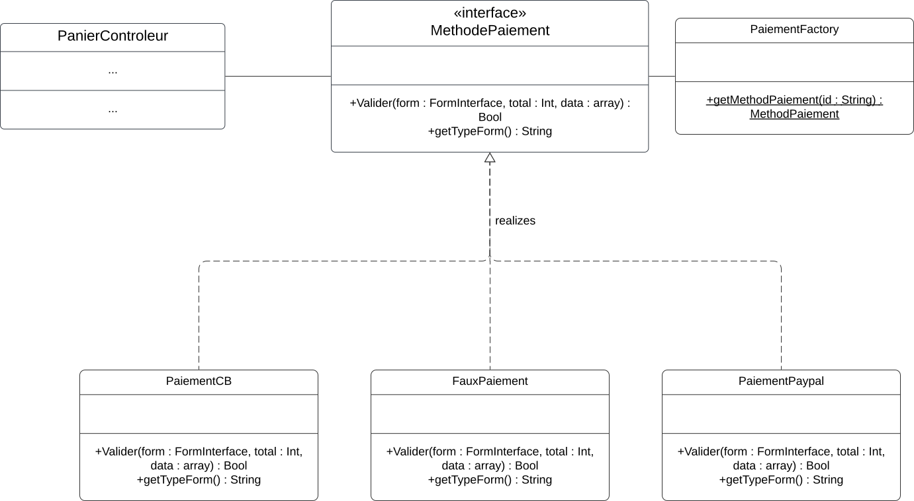
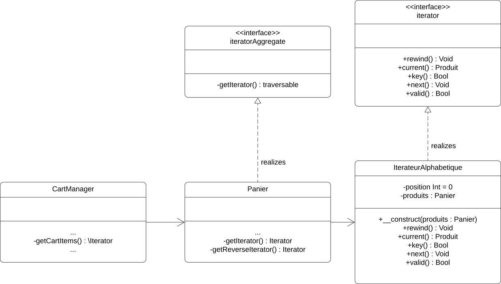
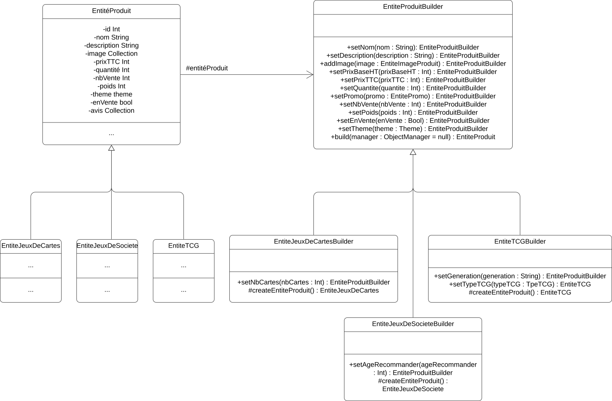

# Oh My Cards — Software Quality & Design Patterns

## Les différents design pattern utilisé

+ Strategy pattern + Factory pattern
+ Iterator pattern
+ Builder pattern

## Strategy pattern
1)
On l'utilise pour changer de moyen de paiement, chaque moyen de paiment est une stratégie.

Avantage :
 
- Il nous permet de changer facilement le moyen de paiement en celui que l'on veut
- Facile à implémenter
- On peut rajouter facilement et rapidement de nouveaux moyens de paiements

Inconvénient :

- Peut créer du code qui se duplique entre les stratégies. Le DP méthode aurais plus contré cet inconvénient mais nous voulions avoir la possibilité de créer les stratégies bien plus librement.

2)

PaiementCB, FauxPaiement et PaiementPaypal sont tout les 3 des stratégies et sont utilisées par PanierControleur

3)
Implémentation de MethodePaiement pour Paypal

```php
class PaiementPaypal implements MethodePaiement
{
    static private $secret = "SuperSecret";

    public function Valider(FormInterface $form, int $total, array $data): bool
    {
        $id = $form->get("id")->getData();

        if ($data['clef'] != md5($id . static::$secret)) {
            return false;
        }

        if (!isset($data['success']) || !$data['success'] || $data['success'] == 'false') {
            return false;
        }

        if (floatval($data['total']) < $total) {
            return false;
        }
        return true;
    }

    public function getTypeForm(): string
    {
        return TypeVide::class;
    }
}
```

Utilisation de la factory et d'un des deux méthode de la stratégie
```php
    ...
    $PaiementMethode = PaiementFactory::getMethodePaiement($type->value);
    $TypeForm = $PaiementMethode->getTypeForm();
    $form = $this->createForm($TypeForm);
    ...
```

Puis plus tard, utilisation de la deuxième méthode des stratégie:
```php
     if ($PaiementMethode->Valider($form, $total, $data)){
         ...
        return $this->render('panier/paiement/payer.html.twig', ['id' => $commande->getId()]);
     }
```

## Iterator pattern
1)
L'iterator va nous permettre d'avoir tous les produits du panier, 
il peut aussi directement trier la sortie des produits si l'on souhaite l'implémenter.

Avantage :
 
- Très facile à implémenter et à utiliser 


2)


3)
```php
class CartManager
{
    ...
    public function getCartItems(): \Iterator {
        $panier = $this->getPanier();
        return $panier->getIterator();
    }
    ...
}

class Panier implements \IteratorAggregate
{
    ...
    public function getIterator(): Iterator
    {
        return new IterateurAlphabetique($this);
    }


    public function getReverseIterator(): Iterator
    {
        return new IterateurAlphabetique($this, true);
    }
}

class IterateurAlphabetique implements \Iterator
{
    private $position = 0;

    public function __construct(private $produits)
    {
    }

    public function rewind() :void
    {
        $this->position = 0;
    }

    public function current()
    {
        return $this->produits->getProduits()[$this->position];
    }

    public function key(): bool
    {
        return $this->position;
    }

    public function next(): void
    {
        $this->position = $this->position + 1;
    }

    public function valid(): bool
    {
        return isset($this->produits->getProduits()[$this->position]);
    }
}

```

## Builder pattern
1)
Le builder pattern nous permet de créer nos produits sans se compliquer à créer plusieurs classe avec les mêmes paramètres et d'en rajouter pour chaque nouveau produit.
Inconvénient :
- Le code devient plus compliqué au niveau de sa structure
- Il faut beaucoup d'écriture

Avantage : 
- On peut l'utiliser pour créer différents produits en partant de la même base
- Il suffit juste de rajouter une nouvelle classe avec les attributs dont elle a besoin en plus de ceux de base (c'est facile à faire)
- Possible d'exécuter du code entre le début et la fin de la création 
2)


3)
```php
abstract class EntiteProduitBuilder
{
    protected EntiteProduit $entiteProduit;

    public function __construct()
    {
        $this->entiteProduit = $this->createEntiteProduit();
    }
...
    public function build(?ObjectManager $manager = null): EntiteProduit
    {
        if ($manager != null) {
            $manager->persist($this->entiteProduit);
        }

        return $this->entiteProduit;
    }
}

class EntiteJeuxDeCartesBuilder extends EntiteProduitBuilder
{
    public function setNbCartes(int $nbCartes): EntiteProduitBuilder
    {
        $this->entiteProduit->setNbCartes($nbCartes);
        return $this;
    }


    protected function createEntiteProduit(): EntiteProduit
    {
        return new EntiteJeuxDeCartes();
    }
}

class EntiteTCGBuilder extends EntiteProduitBuilder
{
    public function setGeneration(string $generation): EntiteProduitBuilder
    {
        $this->entiteProduit->setGeneration($generation);
        return $this;
    }

    public function setTypeTCG(TypeTCG $typeTCG): static
    {
        $this->entiteProduit->setTypeTCG($typeTCG);
        return $this;
    }

    protected function createEntiteProduit(): EntiteProduit
    {
        return new EntiteTCG();
    }
}

class EntiteJeuxDeSocieteBuilder extends EntiteProduitBuilder
{
    public function setAgeRecommander(int $ageRecommader): EntiteProduitBuilder
    {
        $this->entiteProduit->setAgeRecommander($ageRecommader);
        return $this;
    }


    protected function createEntiteProduit(): EntiteProduit
    {
        return new EntiteJeuxDeSociete();
    }
}
```

Il est uniquement utiliser pour nos dataFixtures, ex d'utilisation:
```php
$JDC = EntiteJeuxDeCartes::builder()
                ->setNom('Jeux de Carte n°'.$i)
                ->setDescription("description jeux de carte n°".$i)
                ->setPrixBaseHT(100 + $i*5)
                ->setQuantite(50)
                ->setNbVente(rand(0, 100))
                ->setPoids(20)
                ->setEnVente(true)
                ->setTheme(theme::POKEMON)
                ->setNbCartes(rand(0, 100))
                ->build($manager);
```

